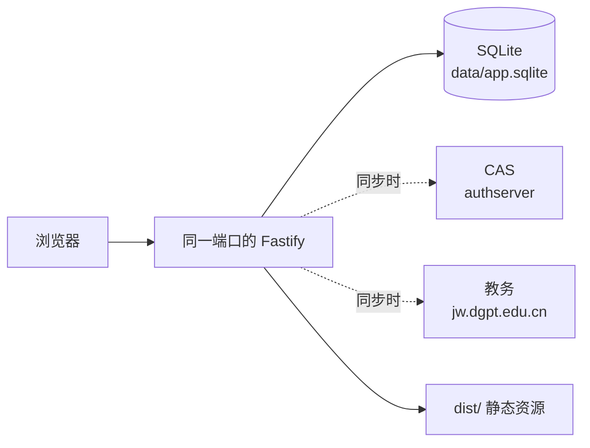

# common-free

`common-free` 用于从教务课表中整理多位教师的公共空闲时段，支持排会、排课等场景。应用以 Node.js 22 运行，使用 `node:sqlite` 保存本地数据，不依赖 ORM。

## 项目简介

系统从 CAS 和教务系统获取教师课表，按学期、周次和教师集合计算 7 天 × 6 节的公共空闲结果。同步过程按学院拉取课表，并用全校总表补充只在总表中出现的教师；这类教师标记为 `UNAFFILIATED`（未分院系）。

## 核心特性

- 按姓名或 `pinyin_initials` 检索教师，并可按学院、专业筛选。
- 支持保存教师分组；数据表名为 `preset_groups` 和 `preset_group_members`。
- 导入 `.csv`、`.txt`、`.tsv` 或直接粘贴的逗号/Tab 分隔文本。也可以粘贴从 Excel 复制出的制表符文本；不解析 `.xlsx` 二进制文件。
- 以 7 天 × 6 节，即 42 个格子，展示公共空闲；冲突等级为 `FREE`、`ONE_BUSY`、`MANY_BUSY`。
- 同步支持登录、滑块挑战和进度查询。滑块界面固定为 300×150 的轨道，提交的 `canvasWidth` 是轨道的 `clientWidth`，`move` 是拖动距离。
- 登录密码使用页面提供的 salt 做 AES。密码不写入数据库；同步任务只保存在进程内。
- Cookie 仅在教师页确实含有 `xnxqh` 且标题不是登录页时写入 `.jw_cookie_cache.json`，目标权限为 `0600`。该缓存不入库、不进 Git。
- 轻量来自较少的生产依赖和原生 SQLite，而不是未经必要的抽象或 ORM。

## 技术栈与架构

- 运行时：Node.js 22（`node:sqlite`）
- 服务端：TypeScript、Fastify
- 前端：Vue 3、Vite
- 数据：SQLite 文件 `data/app.sqlite`
- 生产依赖：`fastify`、`jpeg-js`、`vue`



生产使用一个端口：`npm start` 同时提供 `dist/` 和 `/api`，且 `/api/*` 不交给静态文件处理。默认 `PORT=3000`、`HOST=127.0.0.1`；Docker 中绑定 `0.0.0.0`。

## 快速开始

### 本地开发

```bash
npm install
cp .env.local.example .env.local
# 编辑 .env.local，填入自己的教务配置；不要提交该文件
npm run dev
# 另开终端启动 API 服务
npm start
```

Vite 开发服务器默认使用 5173，并将 `/api` 代理到 3000。

### 构建与生产运行

```bash
npm run build
npm start
```

### Docker

Dockerfile 使用 `node:22-slim` 两阶段构建。Compose 映射 `3000:3000`，挂载 `./data:/app/data` 和 `./.env.local:/app/.env.local`，设置 `restart: unless-stopped`，并设置 `mem_limit: 512m`。该值是容器上限，不代表实测常驻内存。

```bash
docker compose build
docker compose up -d
docker compose ps
```

## 目录结构

```text
.
├── server/src/       # Fastify API、同步、解析器、SQLite 数据访问
├── server/test/      # node:test 测试
├── web/              # Vue 3 前端
├── docs/             # PRD 与工程总结
├── data/             # 运行时 SQLite 数据（不入 Git）
├── Dockerfile
├── docker-compose.yml
└── vite.config.ts
```

`.gitignore` 已忽略 `.env.local`、`.jw_cookie_cache.json`、`data/`、`xu-shu-xitong/`、`probe/` 和 `dist/`。

## API 概览

| 方法 | 路径 | 用途 |
|---|---|---|
| GET | `/api/semesters` | 学期列表 |
| GET | `/api/colleges` | 学院列表 |
| GET | `/api/teachers` | 检索与分页查询教师 |
| GET / POST | `/api/presets` | 查询或创建教师分组 |
| DELETE | `/api/presets/:name` | 删除教师分组 |
| GET / PUT | `/api/settings` | 查询或更新设置 |
| POST | `/api/programs/import` | 导入专业文本 |
| POST | `/api/common-free` | 查询教师公共空闲 |
| POST | `/api/sync/start` | 启动同步 |
| POST | `/api/sync/slider` | 提交滑块轨迹 |
| GET | `/api/sync/:jobId` | 查询同步进度 |

同步请求中的账号和密码只有在两者都非空时才使用请求值；否则两者一起使用环境变量，避免混用来源。
